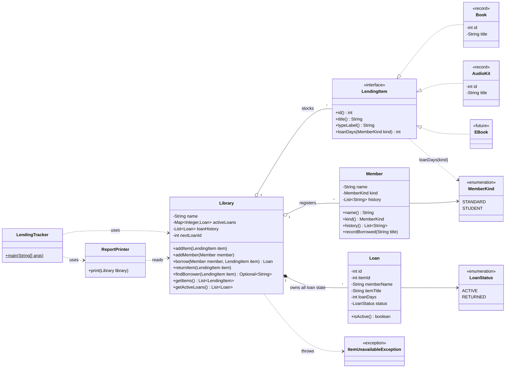

# DIAGNOSIS: The Reading Room Lending Tracker

Written before any code change. It covers what is wrong with the starter code, why it matters to the library, and the structure I plan to build.

## 1. What the program does today

The tracker lends two kinds of item (books and audio kits) to two kinds of member (standard and student). Loan periods are:

| Item | Standard | Student |
|---|---|---|
| Book | 14 days | 28 days |
| Audio kit | 7 days | 14 days |

It keeps a per-member borrowing history and prints an end-of-day report of items and active loans.

## 2. Evidence: the original output

Running the original shows the defect directly:

```
Lent "Things Fall Apart" to Kofi Mensah for 14 days
Lent "French Audio Course" to Ama Owusu for 14 days
Returned "French Audio Course"
Lent "Things Fall Apart" to Ama Owusu for 28 days      <- should be impossible

=== The Reading Room - end of day ===
Items:
  "Things Fall Apart" (BOOK): ON_LOAN - with Ama Owusu  <- item says Ama
  "French Audio Course" (AUDIO_KIT): AVAILABLE
Active loans:
  Loan #1: "Things Fall Apart" -> Kofi Mensah           <- loans say Kofi...
  Loan #3: "Things Fall Apart" -> Ama Owusu             <- ...and Ama
```

The same report gives two different answers to "who has this book?". I will save this output as a golden baseline and keep it as the behaviour reference.

## 3. Problems, ranked by risk to this business

### 1. An item can be lent twice, and availability is stored in two places (MOST DANGEROUS)

- **What:** `borrow()` never checks whether the item is already on loan. Separately, "is it out, and with whom?" is held in two places: `item.status` / `item.currentBorrower`, and the `loans` list in `Library`. Nothing keeps them in agreement.
- **Root cause:** there is no single owner of loan state. Any code can change either copy, and the lending method does not guard the rule.
- **Risk:** the library exists to know who has what. This defect lets the tool give contradictory answers about that. A volunteer reading "with Ama" will chase the wrong person, while the loan list still says Kofi. The book can effectively be lost, and members get unfair or confusing treatment.
- **Why it ranks first:** it is a correctness failure in the one job the tool has. Every other problem below makes the code harder to change; this one makes the output wrong. It is also the rule the business says must never be broken.

### 2. All state is public and mutable

- **What:** `title`, `type`, `status`, `currentBorrower`, `kind`, `history` and the loan fields are all `public` and writable. `Library` and `members` are public lists.
- **Root cause:** no encapsulation. Nothing protects the invariants of any object.
- **Risk:** any code can write `item.status = "banana"` or clear a borrower, bypassing every rule. This is the direct cause of problem 1 and of the volunteers' fear: because anything can touch anything, a change in one place can break another.

### 3. Business rules are hard-coded as string comparisons and copy-pasted branches

- **What:** `borrow()` branches on `"BOOK"`, `"AUDIO_KIT"` and `"STUDENT"`. The two branches repeat the same status, borrower and print code with different numbers.
- **Root cause:** item and member kinds are strings, and the rules live in one central method instead of with the thing they describe.
- **Risk:** this is the reported "changing audio-kit rules broke book returns" problem, because both kinds share one method and one set of fields. It is also the biggest obstacle to the planned e-loans: they would need a third copied branch inside `borrow()`, and probably changes in `returnItem` and the report, each one a chance to break books or audio.

### 4. Unknown item types fail silently but still create records

- **What:** if `item.type` matches neither string, `borrow()` skips the status change and prints nothing, yet it still records a history entry and creates an ACTIVE loan of 0 days.
- **Root cause:** free-text types with no validation and no failure path.
- **Risk:** a typo such as `"Book"` creates phantom loans for an item that never shows as on loan. The report would be wrong with no error to point at.

### 5. Loans reference items and members by title and name text

- **What:** `Loan` stores `memberName` and `itemTitle` strings. `returnItem` closes every active loan whose title matches.
- **Root cause:** no real identity. Two copies of one title, or two members with the same name, are indistinguishable. The `id` fields exist on items and members but are never used for this.
- **Risk:** returning one copy of a popular title can close the loans of other copies. Today this also masks problem 1: returning the novel would close both of the conflicting loans at once.

### 6. Returning does not validate

- **What:** `returnItem` on an item that is not out still resets it and prints "Returned".
- **Root cause:** no check of current state before changing it.
- **Risk:** a mistaken scan gives a false record. This is lower priority because it does not corrupt data. I will preserve the existing behaviour (it is a rebuild, not a redesign) and record it as a known quirk.

### 7. Smaller maintainability issues

- ID counters are `static` globals, so ids depend on what ran earlier in the same JVM, and tests cannot start from a clean state.
- `Library.getLoans()` hands out the internal mutable list.
- Everything is in one file, with no tests and no way to check a change is safe.
- Printing is mixed into the lending logic.

These matter for the next person who inherits the code, but none of them gives wrong answers on its own.

## 4. Priority summary

| # | Problem | Type of harm | Priority |
|---|---|---|---|
| 1 | Double lending / two sources of truth | Wrong data in the core job | Critical |
| 2 | Public mutable state | Enables #1, causes fear of change | High |
| 3 | String-based, copy-pasted rules | Blocks e-loans, causes cross-breakage | High |
| 4 | Silent unknown types | Phantom records | Medium |
| 5 | Title/name as identity | Cross-closing of loans | Medium |
| 6 | Unchecked return | False record | Low |
| 7 | Static counters, leaked list, no tests | Hand-over friction | Low |

## 5. Planned structure (design sketch)

### 5.1 Class diagram



### 5.2 Key points of the plan

- **One owner of loan state.** `Library` keeps a single map of active loans keyed by item id. "On loan", "with whom" and "available" are derived from it. Items carry no status field, so the contradiction in problem 1 cannot be represented. `borrow()` rejects an item that is already out.
- **Rules live with the item.** Each item type answers `loanDays(MemberKind)` itself (polymorphism), replacing the string if/else chain. `Library` depends only on the `LendingItem` interface, never on `Book` or `AudioKit`.
- **Plain interface, not sealed.** E-loans should arrive as one new file with no edit to existing code. Sealing would force an edit to the `permits` list, and there are no type switches for exhaustiveness to protect. `Library` also rejects non-positive loan periods, which guards against a faulty future item type.
- **Enums for member kind and loan status**, which remove string comparison and typo risk.
- **Identity by id**, not by title or name, which fixes problem 5. Records compare by value, so each item carries a unique id and `Library` keys on that. The id is given when the item is created (for example `new Book(1, "Things Fall Apart")`) and `Library` rejects a duplicate id, so there is no static counter. `Loan` stores the `itemId`; the title and member name are kept only so the report can print them.
- **Encapsulation throughout.** Private final fields, validated constructors, read-only views of collections, loan ids generated per `Library` instead of a static global. Only `Library` can create or close a `Loan`.
- **No inheritance hierarchy and no strategy or factory classes.** Books and audio kits share a contract, not state or behaviour, so an interface is enough. Anything more would be over-engineering for two item types.
- **Behaviour preserved.** Same console strings, same ordering, same sequential loan ids. A rejected borrow does not consume an id. The only intended difference is that the double-borrow is now refused.
- **Safety net.** The original output is saved as a golden file, and JUnit tests cover all four loan periods, rejection of a double-borrow, return-then-reborrow, and a test showing that a new item type can be added without changing `Library`.

## 6. Note on changes

The design may change as I build. Any change, and the reason for it, will be recorded in the design notes in the README.